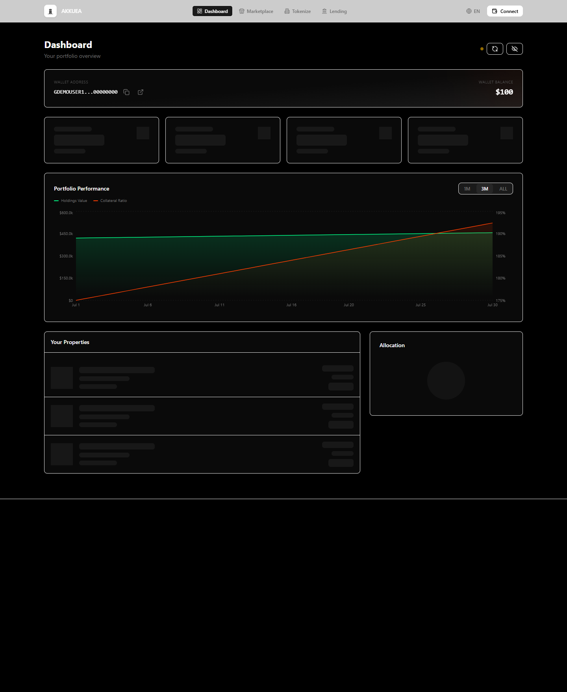
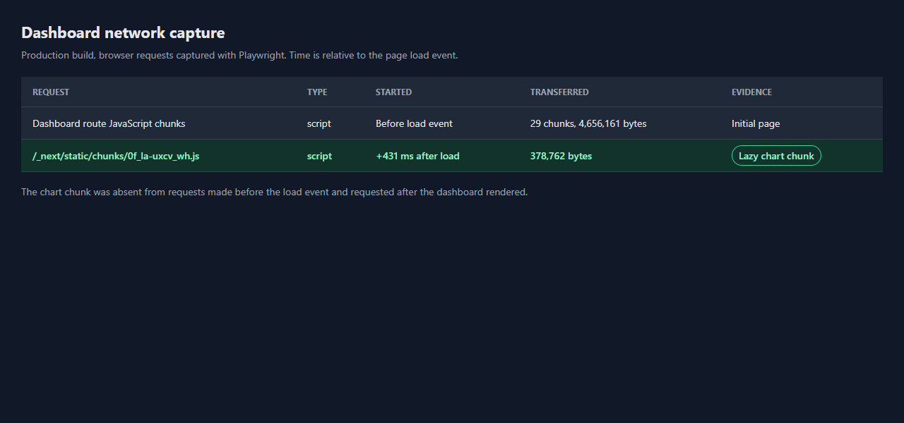

## Summary

Upgrade Recharts to v3 and lazy-load the dashboard portfolio chart. The chart is loaded in a separate client-side chunk, with a matching skeleton shown while it loads.

## Type of Change

- [ ] Bug fix
- [ ] New feature
- [x] Refactor / cleanup
- [ ] Docs / config only
- [ ] Breaking change

## What Changed and Why

- Upgrade `recharts` from `2.15.4` to `^3.10.1` and regenerate `bun.lock`.
- Replace the dashboard's static chart import with a client-only `next/dynamic` import.
- Keep the portfolio barrel export and show the chart skeleton while the chart module loads.
- Update the Recharts v3 tooltip types and mocks, and add a dashboard loading-state test.
- Add a `getTimeSinceUpdate` export to the dashboard test mock so the imported freshness indicator can load.

### Dashboard JavaScript bundle evidence

| Build                  |                                                                             JavaScript requested before page `load` |    Separate chart chunk |
| ---------------------- | ------------------------------------------------------------------------------------------------------------------: | ----------------------: |
| `develop` (`57a12e7b`) | Not measured. A clean baseline dependency install did not complete in time to produce a trustworthy baseline build. |            Not measured |
| Feature branch         |                                                                       4,656,161 bytes across 30 requests (4.44 MiB) | 378,762 bytes (370 KiB) |

The feature-branch measurement counts JavaScript chunk requests observed by Playwright on the production build. The chart chunk was requested 431 ms after the page `load` event. The chart chunk is separate from the 4,656,161-byte initial request total. A like-for-like before/after reduction cannot be claimed until the `develop` build is measured.

### Screenshots

Dashboard after the chart loads:

Playwright-captured request timing. This is a report of browser network events, not a screenshot of the DevTools Network panel:

## How to Test

### How to Verify

1. From the repository root, run `bun install --frozen-lockfile`.
   - Passed: `Checked 1928 installs across 1827 packages (no changes)`.
2. From the repository root, run `bun pm why recharts`.
   - Passed: `recharts@3.10.1`, required by `@akkuea/webapp` as `^3.10.1`.
3. From `apps/webapp`, run `bun run type-check`.
   - Passed.
4. From `apps/webapp`, run `bun run lint`.
   - Passed with 0 errors and 6 warnings.
5. From `apps/webapp`, run `bun test src/components/portfolio "src/app/[locale]/dashboard"`.
   - Passed: 10 tests, 0 failures.
6. From `apps/webapp`, run `env SKIP_ENV_VALIDATION=true bun run build`.
   - Passed: optimized production build completed.
7. From `apps/webapp`, run `bun test --coverage --coverage-threshold=60 --isolate`.
   - Passed: 401 tests across 43 files, 0 failures.
8. For the network evidence, serve the production build, open `/en/dashboard` with an authenticated test wallet, and inspect JavaScript requests. The chart chunk `/_next/static/chunks/0f_la-uxcv_wh.js` was absent before `load` and requested 431 ms after it.

`make check` was run but did not pass. Its report includes workspace formatting failures in files outside this change and dependency audit findings for Storybook and `follow-redirects`. The configured audit also could not reach the npm advisory endpoint on the first run because DNS resolution failed.

## Checklist

- [ ] `make check` passes (it runs the same checks as CI for what I changed)
- [x] I read my own diff and it only contains changes for this issue (no generated files, logs, or unrelated edits)
- [x] I have added or updated tests where applicable
- [ ] I have updated relevant documentation
- [x] No `.env` files or secrets are committed
- [x] Commit messages follow [Conventional Commits](https://www.conventionalcommits.org/)

## Related Issues

Closes #1169
