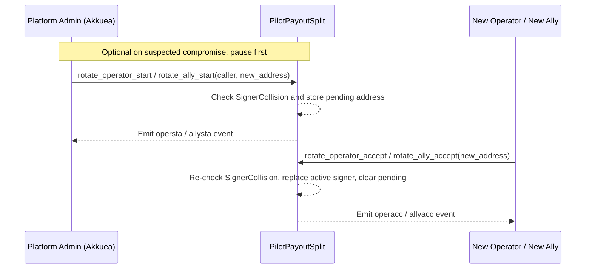

# Runbook: Pilot Role Rotation (`pilot-payout-split`)

**Audience:** Platform admin (Akkuea), pilot operator, and allied real estate agency
**Applies to:** `pilot-payout-split`
**Required keys:**

- Current `admin` Stellar secret key (to start or cancel operator/ally rotations, and to update `platform_fee_recipient`)
- Incoming `new_operator` Stellar secret key (to accept an operator rotation)
- Incoming `new_ally` Stellar secret key (to accept an ally rotation)
  **Contract source:** `apps/contracts/contracts/pilot-payout-split/src/lib.rs`

---

## Why this exists

`pilot-payout-split` gates evidence approvals (`record_evidence`), payout execution (`execute_distribution`), and permanent termination (`exit`) behind both the `operator` and the `ally` keys, and transfers the 10% platform fee to `platform_fee_recipient`.

If either the `operator` or the `ally` key is lost or compromised without a rotation path, no future cycle can be distributed and the contract cannot even be exited. If the `platform_fee_recipient` account is closed or compromised, every distribution continues paying it.

For `admin` key rotation across all three pilot contracts, see [`runbook-pilot-admin-rotation.md`](runbook-pilot-admin-rotation.md). For the recorded authorization design and trust-model rationale behind these entry points, see [`docs/strategy/decision-log.md`](../strategy/decision-log.md) ("Operator, ally, and fee-recipient rotation on `pilot-payout-split`").

---

## Summary of role rotation rules

| Role                   | Flow     | Start / Cancel signer | Accept signer  | Invariant enforced               |
| ---------------------- | -------- | --------------------- | -------------- | -------------------------------- |
| `Operator`             | Two-step | `admin`               | `new_operator` | `new_operator != ally`           |
| `Ally`                 | Two-step | `admin`               | `new_ally`     | `new_ally != operator`           |
| `PlatformFeeRecipient` | One-step | `admin`               | N/A            | Valid initialized contract state |

### Sequence: two-step signer rotation (`operator` or `ally`)



---

## Rotating the operator (two-step)

The current `operator` keeps full operational authority until `new_operator` calls `rotate_operator_accept`. A mistyped or unreachable `new_operator` cannot lock the contract.

### Step 1: start rotation (admin)

```bash
export CONTRACT_ID="<PILOT_PAYOUT_SPLIT contract ID>"
export ADMIN_ADDRESS="<current admin Stellar public key>"
export NEW_OPERATOR_ADDRESS="<new operator Stellar public key>"
export NETWORK="testnet"   # or mainnet, once the pilot is live there

stellar contract invoke \
  --id $CONTRACT_ID \
  --source-account $ADMIN_ADDRESS \
  --network $NETWORK \
  -- rotate_operator_start \
  --caller $ADMIN_ADDRESS \
  --new_operator $NEW_OPERATOR_ADDRESS
```

Verify the pending operator is recorded:

```bash
stellar contract invoke \
  --id $CONTRACT_ID \
  --source-account $ADMIN_ADDRESS \
  --network $NETWORK \
  -- pending_operator
# Expected: $NEW_OPERATOR_ADDRESS
```

### Step 2: accept rotation (new operator, own key)

```bash
stellar contract invoke \
  --id $CONTRACT_ID \
  --source-account $NEW_OPERATOR_ADDRESS \
  --network $NETWORK \
  -- rotate_operator_accept \
  --new_operator $NEW_OPERATOR_ADDRESS
```

Verify the rotation completed:

```bash
stellar contract invoke \
  --id $CONTRACT_ID \
  --source-account $NEW_OPERATOR_ADDRESS \
  --network $NETWORK \
  -- operator
# Expected: $NEW_OPERATOR_ADDRESS

stellar contract invoke \
  --id $CONTRACT_ID \
  --source-account $NEW_OPERATOR_ADDRESS \
  --network $NETWORK \
  -- pending_operator
# Expected: no value
```

Immediately upon acceptance, the old `operator` loses authority over `record_evidence`, `start_review`, `review_evidence`, `flag_dispute` (unless also `admin`), `execute_distribution`, and `exit`.

### Cancel before acceptance (admin)

```bash
stellar contract invoke \
  --id $CONTRACT_ID \
  --source-account $ADMIN_ADDRESS \
  --network $NETWORK \
  -- rotate_operator_cancel \
  --caller $ADMIN_ADDRESS
```

---

## Rotating the ally (two-step)

For planned rotations where the agency still controls its existing wallet, confirm the request with the agency off-chain first, stage the new address with `rotate_ally_start`, and have the agency sign `rotate_ally_accept` with its new wallet. For a lost or compromised ally wallet, pause the contract first (`runbook-pilot-emergency-pause.md`), verify the agency's new wallet address out-of-band, and run Steps 1 and 2 below before unpausing.

### Step 1: start rotation (admin)

```bash
export CONTRACT_ID="<PILOT_PAYOUT_SPLIT contract ID>"
export ADMIN_ADDRESS="<current admin Stellar public key>"
export NEW_ALLY_ADDRESS="<new ally Stellar public key>"
export NETWORK="testnet"   # or mainnet, once the pilot is live there

stellar contract invoke \
  --id $CONTRACT_ID \
  --source-account $ADMIN_ADDRESS \
  --network $NETWORK \
  -- rotate_ally_start \
  --caller $ADMIN_ADDRESS \
  --new_ally $NEW_ALLY_ADDRESS
```

Verify the pending ally is recorded:

```bash
stellar contract invoke \
  --id $CONTRACT_ID \
  --source-account $ADMIN_ADDRESS \
  --network $NETWORK \
  -- pending_ally
# Expected: $NEW_ALLY_ADDRESS
```

### Step 2: accept rotation (new ally, own key)

The agency signs this call from `$NEW_ALLY_ADDRESS`:

```bash
stellar contract invoke \
  --id $CONTRACT_ID \
  --source-account $NEW_ALLY_ADDRESS \
  --network $NETWORK \
  -- rotate_ally_accept \
  --new_ally $NEW_ALLY_ADDRESS
```

Verify the rotation completed:

```bash
stellar contract invoke \
  --id $CONTRACT_ID \
  --source-account $ADMIN_ADDRESS \
  --network $NETWORK \
  -- ally
# Expected: $NEW_ALLY_ADDRESS

stellar contract invoke \
  --id $CONTRACT_ID \
  --source-account $ADMIN_ADDRESS \
  --network $NETWORK \
  -- pending_ally
# Expected: no value
```

Immediately upon acceptance, the old `ally` can no longer call `submit_evidence` or co-sign `record_evidence`, `execute_distribution`, or `exit`. Any partially signed co-sign JSON payload (`cosign.ts`) carrying the old ally's authorization entry becomes invalid and must be re-prepared with the new signer.

### Cancel before acceptance (admin)

```bash
stellar contract invoke \
  --id $CONTRACT_ID \
  --source-account $ADMIN_ADDRESS \
  --network $NETWORK \
  -- rotate_ally_cancel \
  --caller $ADMIN_ADDRESS
```

---

## Updating the platform fee recipient (one-step)

Before rotating `platform_fee_recipient` to a classic Stellar account (`G...`), confirm the destination account already exists on-chain and carries an active USDC trustline so the `usdc.transfer` leg in `execute_distribution` does not trap.

```bash
export CONTRACT_ID="<PILOT_PAYOUT_SPLIT contract ID>"
export ADMIN_ADDRESS="<current admin Stellar public key>"
export NEW_FEE_RECIPIENT="<new fee recipient Stellar address>"
export NETWORK="testnet"   # or mainnet, once the pilot is live there

stellar contract invoke \
  --id $CONTRACT_ID \
  --source-account $ADMIN_ADDRESS \
  --network $NETWORK \
  -- set_platform_fee_recipient \
  --caller $ADMIN_ADDRESS \
  --new_recipient $NEW_FEE_RECIPIENT
```

Verify the updated recipient:

```bash
stellar contract invoke \
  --id $CONTRACT_ID \
  --source-account $ADMIN_ADDRESS \
  --network $NETWORK \
  -- platform_fee_recipient
# Expected: $NEW_FEE_RECIPIENT
```

---

## Behavior while paused and after `exit`

- **While paused (`is_paused == true`):** every rotation call (`rotate_operator_*`, `rotate_ally_*`, and `set_platform_fee_recipient`) keeps working. When responding to a suspected key compromise, **always pause `pilot-payout-split` first** ([`runbook-pilot-emergency-pause.md`](runbook-pilot-emergency-pause.md)), complete the rotation and verify the new address on-chain, then `unpause`.
- **After `exit` (`exit_status != None`):** every rotation write (including accepting or cancelling a rotation started before `exit`) is permanently rejected with `PayoutError::ContractExited` (error code 22). Read entry points (`operator`, `ally`, `platform_fee_recipient`, `pending_operator`, `pending_ally`) remain available.

---

## Emitted events

| Event topic | Payload struct                   | When emitted                          |
| ----------- | -------------------------------- | ------------------------------------- |
| `opersta`   | `OperatorRotationStartedEvent`   | `rotate_operator_start` succeeds      |
| `operacc`   | `OperatorRotationAcceptedEvent`  | `rotate_operator_accept` succeeds     |
| `opercan`   | `OperatorRotationCancelledEvent` | `rotate_operator_cancel` succeeds     |
| `allysta`   | `AllyRotationStartedEvent`       | `rotate_ally_start` succeeds          |
| `allyacc`   | `AllyRotationAcceptedEvent`      | `rotate_ally_accept` succeeds         |
| `allycan`   | `AllyRotationCancelledEvent`     | `rotate_ally_cancel` succeeds         |
| `feerecip`  | `FeeRecipientUpdatedEvent`       | `set_platform_fee_recipient` succeeds |

---

## Common errors

| Error                | Code | Cause                                                                                           | Fix                                                                       |
| -------------------- | ---- | ----------------------------------------------------------------------------------------------- | ------------------------------------------------------------------------- |
| `Unauthorized`       | 3    | Caller of `*_start`, `*_cancel`, or `set_platform_fee_recipient` is not the current admin       | Sign with the current `admin` key on `pilot-payout-split`                 |
| `SignerCollision`    | 17   | Target address equals the active counterpart (`new_operator == ally` or `new_ally == operator`) | Keep `operator` and `ally` distinct addresses                             |
| `ContractExited`     | 22   | Pilot has already been permanently terminated via `exit`                                        | Expected; signer and fee configuration is frozen once `exit` has executed |
| `NotPendingOperator` | 32   | `rotate_operator_accept` called by an address other than `pending_operator`, or none set        | Check `pending_operator` and sign `rotate_operator_accept` with that key  |
| `NotPendingAlly`     | 33   | `rotate_ally_accept` called by an address other than `pending_ally`, or none set                | Check `pending_ally` and sign `rotate_ally_accept` with that key          |
| `NotInitialized`     | 2    | Contract has not been initialized                                                               | Verify `$CONTRACT_ID` points to an initialized `pilot-payout-split`       |

---

## Operational security rules

- On suspected `operator` or `ally` compromise, pause `pilot-payout-split` immediately before starting rotation so no queued or co-signed payload can execute with the compromised key during the handoff window.
- Verify `new_ally` ownership with the agency over an authenticated channel independent of the channel that may have been compromised, and let the agency submit `rotate_ally_accept` from its own environment (never ask for or handle the ally's secret key).
- After rotating `operator`, update `PILOT_OPERATOR_SECRET` / operator wallet configuration in any API worker or runbook environment, and discard any unsubmitted co-sign payloads signed by the retired key.
- Before updating `platform_fee_recipient`, verify on Stellar Horizon/RPC that the destination holds an open USDC trustline (for `G...` accounts) or implements SEP-41 receipt semantics (for `C...` treasury contracts).

---

## See also

- [`docs/operations/runbook-pilot-admin-rotation.md`](runbook-pilot-admin-rotation.md)
- [`docs/operations/runbook-pilot-emergency-pause.md`](runbook-pilot-emergency-pause.md)
- [`docs/operations/runbook-pilot-contract-migration.md`](runbook-pilot-contract-migration.md)
- [`docs/strategy/decision-log.md`](../strategy/decision-log.md)
- [`docs/deployment/deploy-pilot-contracts.md`](../deployment/deploy-pilot-contracts.md)
